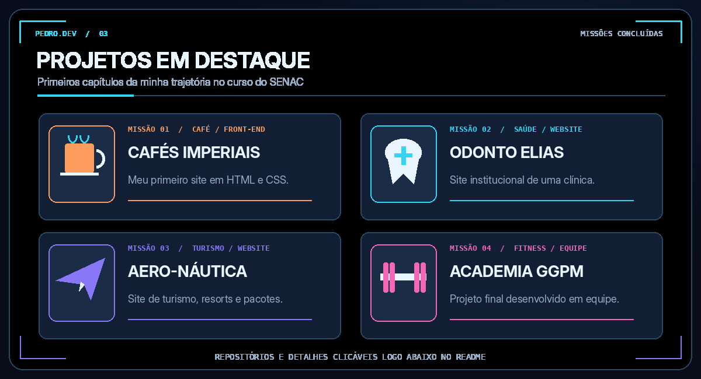

  

  

  
  
  

 

  

<strong>Sobre mim — descrição em texto</strong>

Sou **Pedro Elias**, estudante de **Engenharia de Software na UNICID** e interessado em desenvolvimento **Back-End**. Meu primeiro contato com desenvolvimento web aconteceu no curso básico de **HTML e CSS do SENAC**, onde construí meus primeiros sites. Gosto de aprender na prática, participar de projetos em equipe e desenvolver soluções organizadas.

 

  

<strong>O que estou estudando</strong>

- **HTML5 e CSS3:** estrutura e estilo de páginas web.
- **Linguagem C:** lógica, estruturas e algoritmos, em aprendizado.
- **SQL e modelagem de bancos de dados:** consultas, entidades e relacionamentos, em aprendizado.
- **Git e GitHub:** versionamento, organização e documentação dos projetos.

 

  

| Projeto | Acessar o código |
|:--|:--:|
| **Cafés Imperiais** — meu primeiro site | [Ver repositório](https://github.com/pedrobrandaomarques-max/Cafes-Imperiais) |
| **Odonto Elias** — clínica odontológica fictícia | [Ver repositório](https://github.com/pedrobrandaomarques-max/Clinica-Odontologica) |
| **Aero-Náutica** — turismo e pacotes | [Ver repositório](https://github.com/pedrobrandaomarques-max/Aero-Nautica) |
| **Academia GGPM** — projeto final em equipe | [Ver repositório](https://github.com/pedrobrandaomarques-max/Academia-GGPM) |

 

  

### Atividade no GitHub

  
  

As estatísticas são geradas por um serviço externo e podem apresentar indisponibilidade temporária.

---

  <strong>EM CONSTANTE EVOLUÇÃO — TRANSFORMANDO CONHECIMENTO EM SOLUÇÕES.</strong>

