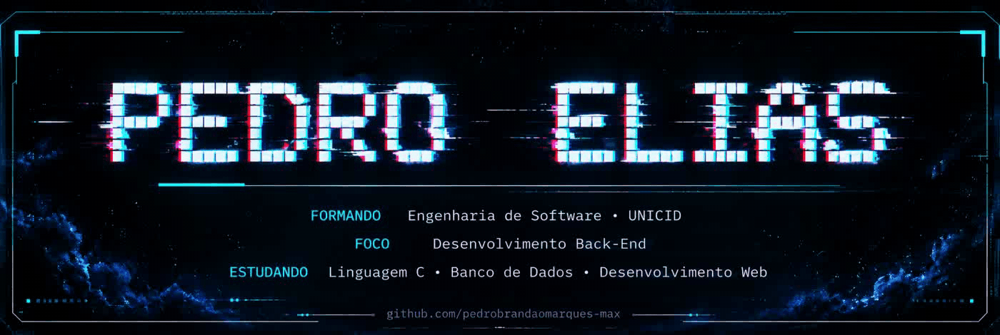
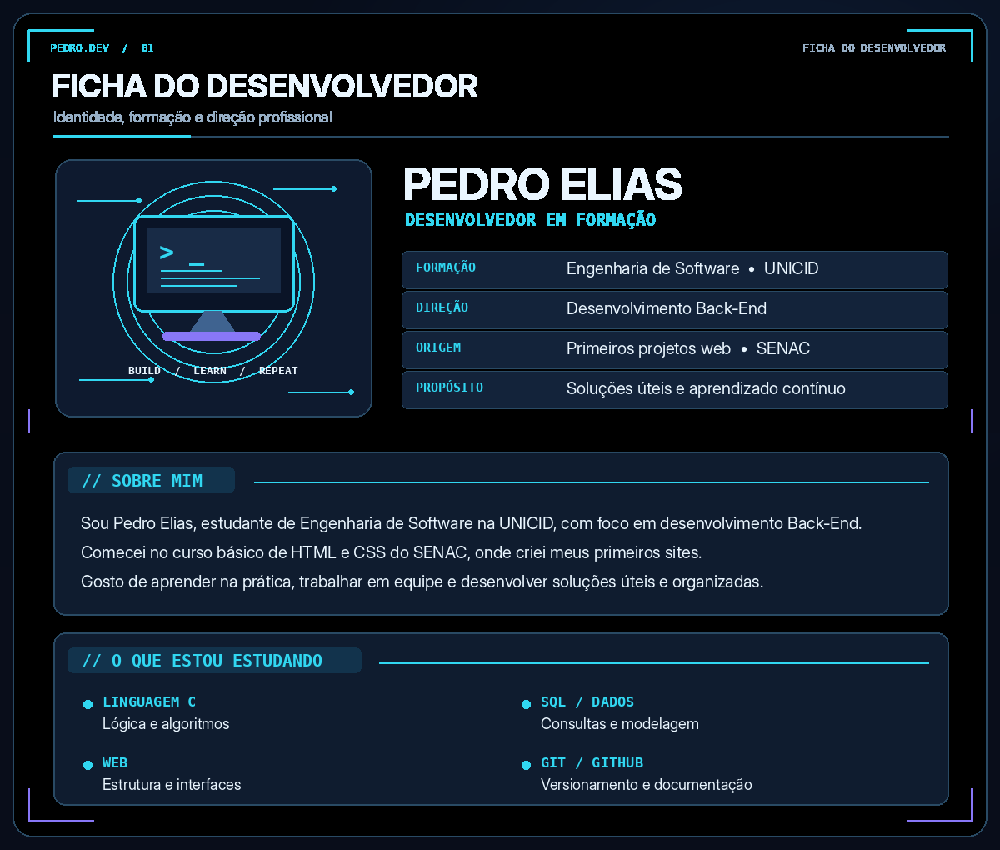
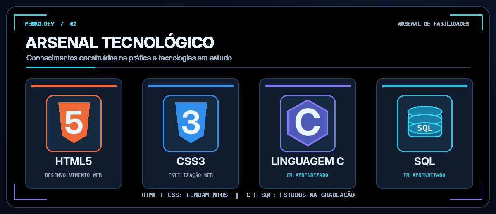
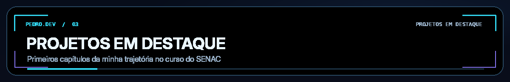
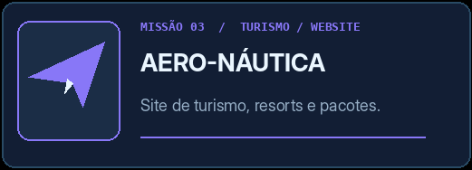
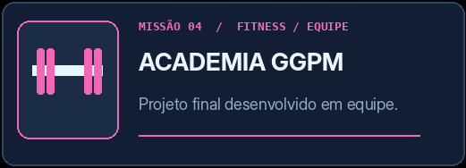
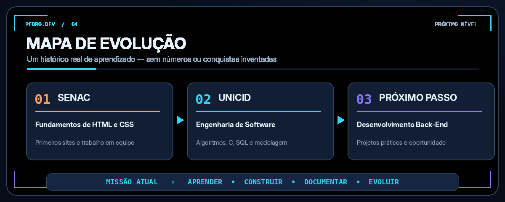
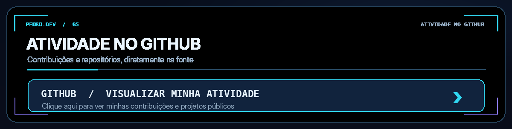

  

  

  
  
  

 

<!-- Sobre mim e estudos agora fazem parte da própria ficha ilustrada. -->

  

 

  

 

  

<!-- Cards dos projetos em formato 2x2. Cada card é clicável e abre o respectivo repositório. -->
<table align="center" width="100%">
  <tr>
    <td width="50%" align="center" valign="top">
      
    </td>
    <td width="50%" align="center" valign="top">
      
    </td>
  </tr>
  <tr>
    <td width="50%" align="center" valign="top">
      
    </td>
    <td width="50%" align="center" valign="top">
      
    </td>
  </tr>
</table>

  Clique em qualquer card para abrir o repositório correspondente.

 

  

 

<!-- Substitui os gráficos externos que apareciam quebrados. -->

  

---

  <strong>EM CONSTANTE EVOLUÇÃO — TRANSFORMANDO CONHECIMENTO EM SOLUÇÕES.</strong>

